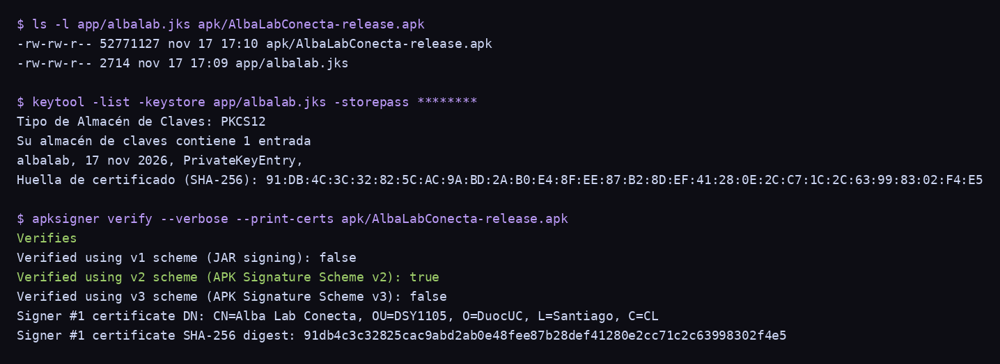

# Alba Lab Conecta - AppAlbaLab

Aplicación Android para el caso **CORPALIV / Alba Lab** (Evaluación Parcial 4).

CORPALIV promueve la inclusión social y laboral de personas con discapacidad múltiple. Quien quiere colaborar encuentra la información repartida en muchos canales. Esta app reúne el propósito de la organización, sus programas y el destino de los aportes, y termina en un formulario para concretar la colaboración (donación, voluntariado, alianza, compra o capacitación).

La app se conecta a nuestros microservicios en Spring Boot (repositorio [AlbaLab-Microservicios](https://github.com/GiuliannoInostroza/AlbaLab-Microservicios)) y a una API externa de indicadores económicos.

## 1. Nombre del proyecto

**Alba Lab Conecta** (repositorio AppAlbaLab).

## 2. Integrantes

- Giulianno Inostroza
- Pascal Pacheco
- Nicolás Pérez

## 3. Funcionalidades

- **Login y registro contra el auth-service**: la cuenta se crea en el microservicio y el login entrega un token JWT que se envía en cada llamada. En el teléfono queda una copia local (Room) con la contraseña cifrada (hash SHA-256).
- **Sesión persistente** con DataStore (correo y token): al reabrir la app la sesión sigue iniciada.
- **Verificación de identidad** después de ingresar: prueba de vida (cámara + ML Kit, 3 gestos al azar), verificación fácil (BiometricPrompt), huella digital o contraseña de la cuenta.
- **Inicio** con propósito, modalidades de colaboración e historia de impacto. Diseño adaptable con WindowSizeClass.
- **Catálogo de programas y productos** que llega desde el contenidos-service, con filtro dinámico mientras se escribe.
- **Formulario "Quiero colaborar"** con texto, número, fecha, lista desplegable, switch y checkbox, todos validados.
- **CRUD de colaboraciones en el vinculacion-service**: crear (POST), listar (GET), editar (PUT) y eliminar (DELETE). El servidor asigna el estado RECIBIDA y la fecha de creación.
- **Indicadores del día (API externa)**: UF, dólar y UTM desde mindicador.cl, consumidos con Retrofit.
- **Perfil** con foto desde la galería o la cámara.
- **Notificación local** al registrar una colaboración y recordatorio con WorkManager.
- **Pruebas unitarias** (Kotest + MockK + JUnit 5) y **prueba de interfaz** (Compose UI Test).
- **APK firmado** con la llave `albalab.jks`.

## 4. Endpoints utilizados

### API externa (Retrofit, `data/remote/ApiService.kt` y `RetrofitInstance.kt`)

| Método | URL | Uso en la app |
|---|---|---|
| GET | `https://mindicador.cl/api` | Pantalla "Indicadores del día" (UF, dólar y UTM) |

### Microservicios propios (Retrofit, `data/remote/MicroserviciosService.kt` y `RetrofitMicroservicios.kt`)

Todas las llamadas pasan por el **api-gateway** en `http://10.0.2.2:9090/` (10.0.2.2 es el computador visto desde el emulador). Las rutas que no son `/auth` necesitan el encabezado `Authorization: Bearer <token>`.

| Método | Endpoint | Microservicio | Uso en la app |
|---|---|---|---|
| POST | `/auth/register` | auth-service (9094) | Crear cuenta |
| POST | `/auth/login` | auth-service (9094) | Iniciar sesión y obtener el token JWT |
| GET | `/programas` | contenidos-service (9091) | Catálogo de programas y productos |
| GET | `/solicitudes/usuario/{correo}` | vinculacion-service (9092) | Mis registros |
| POST | `/solicitudes` | vinculacion-service (9092) | Enviar una colaboración |
| PUT | `/solicitudes/{id}` | vinculacion-service (9092) | Editar una colaboración |
| DELETE | `/solicitudes/{id}` | vinculacion-service (9092) | Eliminar una colaboración |

## 5. Pasos para ejecutar

1. Levantar los microservicios siguiendo el README de [AlbaLab-Microservicios](https://github.com/GiuliannoInostroza/AlbaLab-Microservicios) (MySQL encendido, `build-all.bat` y `docker compose up -d`).
2. Clonar este repositorio y abrirlo en Android Studio.
3. Esperar a que Gradle sincronice las dependencias.
4. Crear un dispositivo en Device Manager (por ejemplo Pixel 7 con API 35) y presionar **Run**.
5. Crear una cuenta en "Regístrate" y elegir un método de verificación (en el emulador: contraseña de la cuenta o huella simulada).

### Pruebas

- **Unitarias** (`app/src/test`): clic derecho en la carpeta `test` > **Run Tests**. Para ver el porcentaje: **Run Tests with Coverage**. Desde la terminal: `./gradlew testDebugUnitTest`.
- **De interfaz** (`app/src/androidTest`): con el emulador encendido, clic derecho en `IndicadoresScreenTest` > **Run**. Desde la terminal: `./gradlew connectedDebugAndroidTest`.

| Archivo de prueba | Qué prueba |
|---|---|
| `repository/IndicadorRepositoryTest` | Lectura de la API externa con un `ApiService` simulado |
| `repository/ProgramaRepositoryTest` | Programas del contenidos-service enviando el token |
| `repository/ColaboracionRepositoryTest` | POST, PUT, GET y DELETE del vinculacion-service |
| `repository/UsuarioRepositoryTest` | Registro, login con token y clave cifrada |
| `viewmodel/IndicadorViewModelTest` | Carga de indicadores (subclase falsa como en la guía y con MockK) |
| `viewmodel/ProgramasViewModelTest` | Carga, filtro y errores de conexión o token vencido |
| `viewmodel/ColaboracionViewModelTest` | Validaciones del formulario y CRUD |
| `viewmodel/UsuarioViewModelTest` | Sesión, login, registro, verificación y cierre de sesión |
| `viewmodel/MainViewModelTest` | Eventos de navegación |
| `viewmodel/PruebaVidaViewModelTest` | Gestos de la prueba de vida |
| `androidTest/ui/IndicadoresScreenTest` | Que los indicadores aparezcan en pantalla |

Resultado: 56 pruebas unitarias aprobadas, con 98 % de las líneas de los paquetes `viewmodel` y `data/repository` cubiertas.

## 6. APK firmado y llave

- APK firmado: [`apk/AlbaLabConecta-release.apk`](apk/AlbaLabConecta-release.apk)
- Llave: [`app/albalab.jks`](app/albalab.jks) (alias `albalab`)
- Configuración de la firma: bloque `signingConfigs` en [`app/build.gradle.kts`](app/build.gradle.kts)

Pasos:

1. Crear la llave (en Android Studio: **Build > Generate Signed App Bundle / APK > APK > Create new**; equivale a este comando):
   `keytool -genkeypair -v -keystore app/albalab.jks -alias albalab -keyalg RSA -keysize 2048 -validity 10000`
2. Agregar el bloque `signingConfigs` en `app/build.gradle.kts` y asignarlo al `buildType` **release**.
3. Generar el APK: **Build > Generate Signed App Bundle / APK** (variante release) o `./gradlew assembleRelease`. Queda en `app/build/outputs/apk/release/app-release.apk`.
4. Verificar la firma: `apksigner verify --print-certs app-release.apk`.



## Arquitectura (MVVM)

```
app/src/main/java/com/example/albalab/
├── MainActivity.kt          Punto de entrada
├── navigation/              Rutas (sealed class Screen), eventos y NavHost
├── viewmodel/               Estado de las pantallas y validaciones
├── data/
│   ├── model/               Modelos, entidades de Room y estados de formularios
│   ├── local/               Base de datos Room, DAO y DataStore
│   ├── remote/              Retrofit: API externa y microservicios
│   └── repository/          Obtienen y guardan los datos
└── ui/
    ├── theme/               Colores, tipografía y tema
    ├── components/          Composables reutilizables
    ├── screens/             Pantallas
    └── utils/               Tamaño de pantalla y formato de fechas
```

## Tecnologías

Kotlin, Jetpack Compose, Material 3, Navigation Compose, ViewModel + StateFlow, Retrofit + Gson, corrutinas, Room, DataStore, Coil, CameraX, ML Kit Face Detection, Biometric, WorkManager, Kotest, MockK, JUnit 5 y Compose UI Test.

## Requisitos

- Android Studio actualizado
- Android 8.0 (API 26) o superior
- Microservicios encendidos para iniciar sesión, ver programas y registrar colaboraciones
